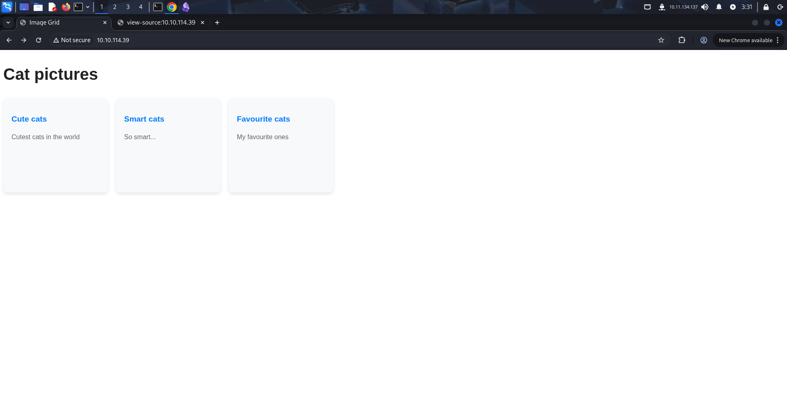
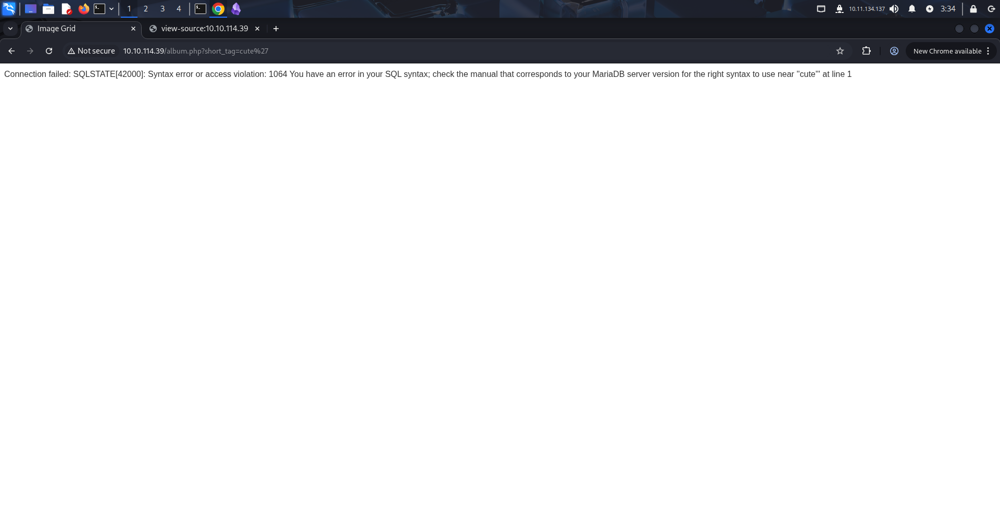
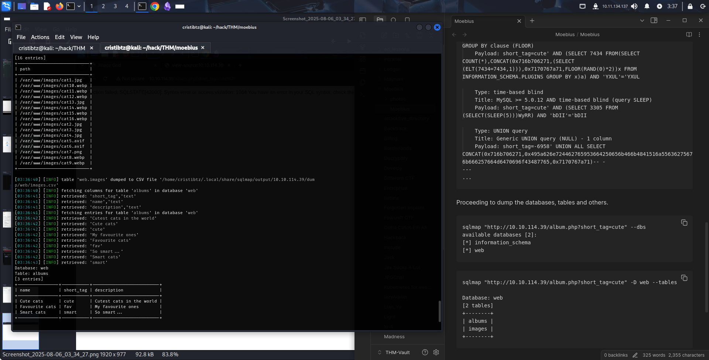
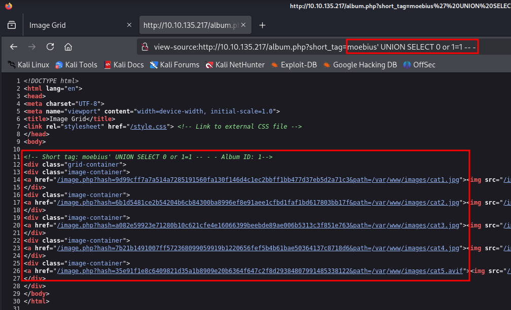
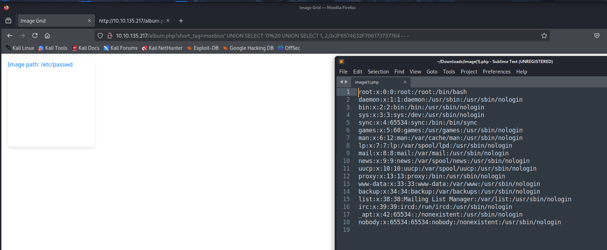
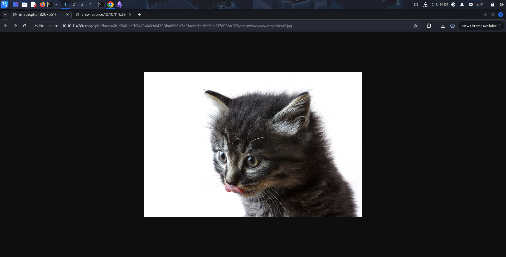
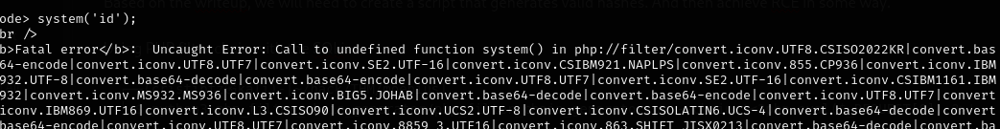
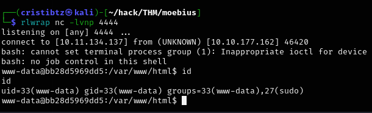
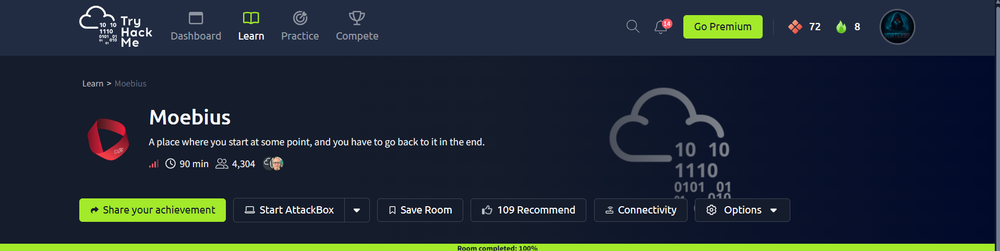

<div class="ctf-hero">

  <h1>Moebius</h1>

  <p>
    A technical penetration-testing walkthrough of the TryHackMe Moebius lab, documenting the path from web application enumeration and SQL injection to PHP source disclosure, application-level code execution, privileged container compromise, and host filesystem access.
  </p>

  <div class="ctf-badges">
    <span class="ctf-badge">TryHackMe</span>
    <span class="ctf-badge">Linux</span>
    <span class="ctf-badge">Web Exploitation</span>
    <span class="ctf-badge">SQL Injection</span>
    <span class="ctf-badge">PHP</span>
    <span class="ctf-badge">Docker Security</span>
  </div>

</div>

<p align="center">
  
</p>

<p align="center">
  
  
  
</p>

---

## Navigation

<div class="ctf-toc">
<div class="ctf-toc-title">Documentation Map</div>

<ul>
  <li><a href="#mission-and-executive-summary">Mission and Executive Summary</a></li>
  <li><a href="#quick-overview">Quick Overview</a></li>
  <li><a href="#assessment-objectives">Assessment Objectives</a></li>
  <li><a href="#scope-and-responsible-use">Scope and Responsible Use</a></li>
  <li><a href="#assessment-methodology">Assessment Methodology</a></li>
  <li><a href="#target-information-and-attack-surface">Target Information and Attack Surface</a></li>
  <li><a href="#reconnaissance">Reconnaissance</a></li>
  <li><a href="#web-application-enumeration">Web Application Enumeration</a></li>
  <li><a href="#sql-injection-analysis">SQL Injection Analysis</a></li>
  <li><a href="#database-enumeration">Database Enumeration</a></li>
  <li><a href="#union-based-sql-manipulation">UNION-Based SQL Manipulation</a></li>
  <li><a href="#local-file-disclosure">Local File Disclosure</a></li>
  <li><a href="#php-source-analysis-and-hmac">PHP Source Analysis and HMAC</a></li>
  <li><a href="#application-level-code-execution">Application-Level Code Execution</a></li>
  <li><a href="#initial-access">Initial Access</a></li>
  <li><a href="#container-security-analysis">Container Security Analysis</a></li>
  <li><a href="#host-filesystem-access">Host Filesystem Access</a></li>
  <li><a href="#host-side-database-enumeration">Host-Side Database Enumeration</a></li>
  <li><a href="#attack-chain-summary">Attack Chain Summary</a></li>
  <li><a href="#mitre-attck-mapping">MITRE ATT&CK Mapping</a></li>
  <li><a href="#security-findings">Security Findings</a></li>
  <li><a href="#defensive-recommendations">Defensive Recommendations</a></li>
  <li><a href="#detection-and-monitoring-opportunities">Detection and Monitoring Opportunities</a></li>
  <li><a href="#lessons-learned">Lessons Learned</a></li>
  <li><a href="#assessment-outcome">Assessment Outcome</a></li>
  <li><a href="#tools-used">Tools Used</a></li>
  <li><a href="#references">References</a></li>
  <li><a href="#conclusion">Conclusion</a></li>
  <li><a href="#repository-information">Repository Information</a></li>
  <li><a href="#responsible-use-disclaimer">Responsible Use Disclaimer</a></li>
</ul>

</div>

---

## Mission and Executive Summary

The objective of this assessment was to investigate the attack surface of the **Moebius** room on TryHackMe and follow the documented exploitation path from the exposed web application into its underlying Linux and container environment.

The assessment began with network reconnaissance and web application enumeration. Testing of the `short_tag` parameter in `album.php` identified SQL injection vulnerabilities. SQL manipulation was then used to reach a local file-disclosure primitive, which enabled the retrieval of Linux files and PHP source code.

The disclosed source revealed database query construction, input filtering, image-path handling, and an HMAC-based mechanism used to protect file retrieval. Subsequent analysis documented a PHP stream-filter execution attempt and a supplied `LD_PRELOAD`-based technique associated with the resulting shell access.

The established shell operated as `www-data` inside the web container. Subsequent enumeration identified an extensive effective capability mask, while the recovered Docker Compose configuration explicitly declared `privileged: true`. Host block-device access was then used to mount a host filesystem, exposing deployment configuration and database-related files.

The final stage of the supplied walkthrough identified a database named `secret` containing a `secrets` table. The challenge value and sensitive database credentials remain intentionally redacted in this public portfolio document.

<div class="key-finding">
  <div class="key-finding-title">Primary Security Finding</div>

  The documented compromise was not limited to a web application vulnerability. SQL injection enabled file disclosure, file disclosure exposed application implementation details, application-level execution provided a shell, and excessive container privileges allowed access to the host filesystem. The combined impact demonstrates how application-layer weaknesses and container misconfiguration can form a single compromise path.
</div>

### Assessment at a Glance

<div class="ctf-card-grid">

  <div class="ctf-card">
    <div class="ctf-card-title">Platform</div>
    <div class="ctf-card-value">TryHackMe</div>
  </div>

  <div class="ctf-card">
    <div class="ctf-card-title">Target</div>
    <div class="ctf-card-value">Moebius</div>
  </div>

  <div class="ctf-card">
    <div class="ctf-card-title">Environment</div>
    <div class="ctf-card-value">Linux / Docker</div>
  </div>

  <div class="ctf-card">
    <div class="ctf-card-title">Primary Attack Surface</div>
    <div class="ctf-card-value">HTTP Web Application</div>
  </div>

  <div class="ctf-card">
    <div class="ctf-card-title">Key Application Issue</div>
    <div class="ctf-card-value">SQL Injection</div>
  </div>

  <div class="ctf-card">
    <div class="ctf-card-title">Documented Outcome</div>
    <div class="ctf-card-value">Host Filesystem Access</div>
  </div>

</div>

## Quick Overview

| Attribute | Assessment Detail |
|---|---|
| Challenge | Moebius |
| Platform | TryHackMe |
| Assessment type | Black-box CTF assessment |
| Operating environment | Linux / containerized web application |
| Web server | Apache 2.4.62 (Debian) |
| Database technology | MariaDB |
| Primary web endpoint | `album.php` |
| Tested parameter | `short_tag` |
| Application file endpoint | `image.php` |
| Initial shell identity | `www-data` |
| Container configuration issue | `privileged: true` |
| Host-access mechanism | Host block-device mounting |
| Final challenge value | Intentionally redacted |

The original notes contain two distinct target addresses in different stages of the walkthrough: `10.10.114.39` in the initial Nmap command and `10.10.177.162` in the reverse-shell evidence. Both values are retained as recorded; they are not assumed to represent the same target instance or the same lab allocation.

## Assessment Objectives

The walkthrough addresses the following objectives, based on the documented activities:

1. Identify the externally accessible services and establish the web application's attack surface.
2. Test the `short_tag` parameter for SQL injection and determine the available database enumeration capabilities.
3. Investigate the application's file-disclosure behavior and recover relevant application source code.
4. Examine the image-retrieval endpoint, its HMAC mechanism, and its security-sensitive implementation details.
5. Document the supplied PHP execution path and the evidence of initial shell access.
6. Evaluate the container's effective capabilities and deployment configuration.
7. Investigate host filesystem exposure and identify the database-related artifacts present in the mounted environment.
8. Derive defensive recommendations from the observed application and container security failures.

## Scope and Responsible Use

This writeup documents a controlled TryHackMe training environment. The activities discussed include network scanning, web application testing, SQL injection, local file disclosure, PHP source analysis, application-level execution, reverse-shell access, container enumeration, and host filesystem access.

The findings and exploitation chain are specific to the evidence recorded in the supplied walkthrough. They should not be interpreted as a claim that the same configuration or vulnerabilities exist in any unrelated production system.

Sensitive challenge material has been intentionally redacted. No missing credentials, source files, flags, or exploit artifacts have been reconstructed.

---

## Assessment Methodology

The assessment followed the attack progression documented in the original notes.

<div class="attack-chain">
  <div class="attack-step">Reconnaissance</div>
  <div class="attack-arrow">→</div>
  <div class="attack-step">Web Enumeration</div>
  <div class="attack-arrow">→</div>
  <div class="attack-step">SQL Injection</div>
  <div class="attack-arrow">→</div>
  <div class="attack-step">File Disclosure</div>
  <div class="attack-arrow">→</div>
  <div class="attack-step">PHP Source Analysis</div>
  <div class="attack-arrow">→</div>
  <div class="attack-step">Application Execution</div>
  <div class="attack-arrow">→</div>
  <div class="attack-step">Container Access</div>
  <div class="attack-arrow">→</div>
  <div class="attack-step">Host Filesystem Access</div>
  <div class="attack-arrow">→</div>
  <div class="attack-step">Database Investigation</div>
</div>

The methodology combined service identification, input validation, database enumeration, source-code review, shell-environment analysis, and examination of container deployment settings.

The progression matters because the later stages depended on weaknesses discovered earlier. In particular, source disclosure provided implementation details that would not ordinarily be available to an unauthenticated remote user, while the container configuration extended the consequences of application compromise beyond the container itself.

## Target Information and Attack Surface

### Recorded Target Details

| Property | Recorded Value |
|---|---|
| CTF name | Moebius |
| Platform | TryHackMe |
| Initial Nmap target | `10.10.114.39` |
| Target address in reverse-shell evidence | `10.10.177.162` |
| Exposed web service | HTTP |
| Web server | Apache 2.4.62 (Debian) |
| SSH service | OpenSSH 8.9p1 |
| Application | Image Grid |
| Primary application endpoint | `/album.php?short_tag=cute` |
| File retrieval endpoint | `image.php` |

### Exposed Services

The initial scan identified two relevant TCP services.

| Port | Service | Version | Security Relevance |
|---:|---|---|---|
| `22/tcp` | SSH | OpenSSH 8.9p1 | Remotely accessible SSH service identified by the scan |
| `80/tcp` | HTTP | Apache 2.4.62 (Debian) | Exposed web application and primary documented attack surface |

The supplied notes do not establish successful SSH authentication or exploitation. The documented compromise path proceeds through the HTTP application.

---

## Reconnaissance

### Network and Service Enumeration

The initial service-identification command was:

```bash
sudo nmap -sS -sV -p- -A 10.10.114.39
```

**Purpose:** Identify TCP ports, detect service versions, and collect additional service and host information.

The scan options are:

| Option | Purpose |
|---|---|
| `-sS` | Perform a TCP SYN scan |
| `-sV` | Probe detected services to identify versions |
| `-p-` | Scan all TCP ports |
| `-A` | Enable OS detection, version detection, script scanning, and traceroute-related functionality |

The command identified SSH on port 22 and HTTP on port 80. The web service exposed an Image Grid application, which became the principal focus of subsequent testing.

<figure>
  
  <figcaption>Figure 01 — Image Grid application exposed by the target web service.</figcaption>
</figure>

### Reconnaissance Outcome

The initial reconnaissance established a limited, clearly identifiable network attack surface. Although SSH was present, the supplied evidence focuses on the web application because its input-handling behavior exposed the documented vulnerability chain.

---

## Web Application Enumeration

### Application Entry Point

The application exposed album functionality through the following endpoint:

```text
/album.php?short_tag=cute
```

The `short_tag` parameter appeared to influence the album data returned by the application. This made it a suitable input for testing how the application handled unexpected values and database-special characters.

The investigation subsequently identified three application files.

### Content Discovery

The original directory-discovery command was:

```bash
ffuf -u http://TARGET/FUZZ \
     -w /usr/share/wordlists/SecLists/Discovery/Web-Content/directory-list-2.3-medium.txt \
     -e .php -ac
```

**Purpose:** Discover accessible web paths by substituting candidate entries from a wordlist into the `FUZZ` position.

| Option | Purpose |
|---|---|
| `-u` | Set the target URL containing the fuzzing position |
| `-w` | Specify the wordlist |
| `-e .php` | Add `.php` as a candidate extension |
| `-ac` | Enable automatic calibration to help filter baseline responses |

The supplied results identified the following application files:

```text
index.php
image.php
album.php
```

These endpoints corresponded to the principal areas of the documented web investigation: application entry-point analysis, image retrieval, and album-query processing.

### Enumeration Assessment

The significant discovery was not simply the presence of multiple PHP files. It was the identification of `album.php` as an input-driven database endpoint and `image.php` as a file-retrieval component whose implementation later became important to the assessment.

---

## SQL Injection Analysis

### Initial Detection

An invalid value supplied to `short_tag` produced a MariaDB syntax error.

<figure>
  
  <figcaption>Figure 02 — Database error behavior indicating that the supplied parameter reaches SQL processing.</figcaption>
</figure>

Database-generated syntax errors can reveal that user-controlled input is reaching a query-processing path. In this case, the error supplied an initial indicator that the parameter was not being handled safely.

The finding was subsequently tested with sqlmap.

### SQL Injection Validation

The supplied command was:

```bash
sqlmap "http://TARGET/album.php?short_tag=cute"
```

The documented output identified the following SQL injection classes:

| Technique | Significance |
|---|---|
| Boolean-based blind SQL injection | Query behavior can disclose information through differences in true and false conditions |
| Error-based SQL injection | Database errors can expose information through error responses |
| Time-based blind SQL injection | Query execution timing can provide an information-disclosure channel |
| UNION-based SQL injection | Additional query results can be combined with the application's result set |

The UNION-based technique was particularly relevant because the supplied evidence showed attacker-controlled values being reflected in the generated HTML.

### Technical Assessment

The primary issue was unsafe SQL query construction using data controlled through the `short_tag` parameter.

A secure implementation should treat the album tag strictly as data, rather than allowing its contents to change the structure or semantics of the SQL statement.

The original notes do not include the complete vulnerable SQL statement. Accordingly, this writeup does not reconstruct the precise application query or claim a particular source-code implementation beyond the behavior documented by the test results.

---

## Database Enumeration

The documented database enumeration command was:

```bash
sqlmap "http://TARGET/album.php?short_tag=cute" --dbs
```

The output identified the following databases:

```text
information_schema
web
```

The `information_schema` database exposes metadata about database objects. The application-specific `web` database was the next focus of the documented investigation.

The `web` database contained two tables:

```text
albums
images
```

<figure>
  
  <figcaption>Figure 03 — Database enumeration identifying the web database and its tables.</figcaption>
</figure>

### Why This Discovery Matters

Database enumeration established that the SQL injection extended beyond error generation: the supplied testing identified application database names and table names.

The `albums` and `images` tables were consistent with the application's visible album and image functionality. The relationship between these tables was not fully documented in the source material, so no schema or relational constraints are inferred here.

---

## UNION-Based SQL Manipulation

The supplied evidence recorded the following input:

```text
moebius' UNION SELECT 0 -- -
```

A second input used a conditional expression:

```text
moebius' UNION SELECT 0 or 1=1 -- -
```

The resulting HTML reflected the injected value.

<figure>
  
  <figcaption>Figure 04 — UNION-based SQL manipulation reflected in the application response.</figcaption>
</figure>

### Technical Interpretation

A UNION-based injection attempts to combine attacker-controlled query results with results expected by the application. Successful reflection is evidence that injected content can influence the response generated by the database-backed application.

The supplied example records a single selected value. This writeup does not infer an undocumented column count, full query structure, or additional database contents beyond the evidence provided.

### Security Implication

The application was not reliably separating user-supplied data from SQL instructions. This failure enabled database enumeration and formed the basis for subsequent investigation of the application's file-disclosure behavior.

---

## Local File Disclosure

### Observed Input Filter

The supplied PHP fragment filtered forward slashes and semicolons from the `short_tag` parameter:

```php
if (preg_match('/[\/;]/', $_GET['short_tag'])) {
    die("Hacking attempt");
}
```

This check represents a character blacklist rather than a robust validation policy for the intended input.

The documented walkthrough demonstrated that the filesystem path:

```text
/etc/passwd
```

could be represented as a hexadecimal SQL literal:

```text
0x2F6574632F706173737764
```

The supplied evidence showed that this alternate representation bypassed the character filter in the SQL processing path and enabled local file retrieval.

<figure>
  
  <figcaption>Figure 05 — Local file disclosure of /etc/passwd through the documented injection chain.</figcaption>
</figure>

### Root Cause

The key weakness was the reliance on a limited character blacklist to control security-sensitive input. Alternate representations can undermine such checks when filtering occurs at one processing layer but interpretation happens at another.

The more fundamental issue was the combination of unsafe SQL handling and a query path that could be influenced to retrieve local files.

### Impact

The supplied evidence demonstrates disclosure of `/etc/passwd` and subsequent PHP source retrieval. This represents a substantial expansion of the attack surface because information from the server's filesystem can reveal application internals and security-sensitive configuration.

The source material does not establish that every local file was readable. The finding is limited to the documented disclosure path and recovered artifacts.

---

## PHP Source Analysis and HMAC

### Image Retrieval Endpoint

The application exposed image retrieval through the following parameter pattern:

```text
image.php?hash=<HMAC>&path=<path>
```

The recovered source showed the use of an HMAC generated with:

```php
hash_hmac('sha256', $path, $SECRET_KEY)
```

The purpose of this mechanism was to produce a keyed integrity value associated with the requested path.

The original walkthrough reports that the application secret was recovered from configuration through the same file-disclosure primitive. The actual secret is intentionally omitted from this public case study.

### Security Significance of HMAC

HMAC can help an application verify that a value was generated by a party possessing the shared secret. However, it does not independently make an arbitrary filesystem path safe.

A secure image-retrieval design must also enforce appropriate path restrictions, constrain accessible resources, and prevent access to files outside the intended application data set.

In the documented case, the file-disclosure weakness and recovered secret undermined the intended protection around image retrieval.

### PHP Stream-Filter Analysis

The walkthrough recorded the following PHP stream-filter resource:

```text
php://filter/read=convert.base64-encode/resource=/var/www/html/index.php
```

The `php://filter` wrapper can apply a filter while a resource is being read. The recorded `convert.base64-encode` filter was used to encode the contents of the specified PHP source file.

This was significant because PHP source retrieval can disclose implementation details that are normally executed by the interpreter rather than returned as source text.

### Information Recovered

The supplied source analysis identified the following areas:

- Database connection logic.
- SQL query construction.
- The `/` and `;` input blacklist.
- Image-path handling.
- HMAC generation.
- Application configuration.

<figure>
  
  <figcaption>Figure 06 — Application file-retrieval endpoint used during source-disclosure analysis.</figcaption>
</figure>

### Source-Disclosure Assessment

Source disclosure provided an opportunity to evaluate the application's trust boundaries and identify security-sensitive implementation details. The combination of file retrieval, recoverable configuration, and database-driven input handling substantially increased the impact of the initial SQL injection.

The recovered source file contents are not reproduced in full because the supplied material does not include those complete files.

---

## Application-Level Code Execution

### PHP Filter-Chain Attempt

The supplied material recorded the use of a PHP filter-chain generator:

```bash
python3 php_filter_chain_generator/php_filter_chain_generator.py \
  --chain '<?php eval($_REQUEST[0]);?>'
```

The documented execution path reached PHP but encountered a disabled `system()` function.

<figure>
  
  <figcaption>Figure 07 — The filter-chain execution path reached PHP but encountered a disabled execution function.</figcaption>
</figure>

The error demonstrated that the execution path encountered a runtime restriction. It did not, by itself, establish that every process-execution method was disabled.

### Supplied LD_PRELOAD Technique

The documented workflow then moved to an `LD_PRELOAD`-based technique.

The supplied compilation command was:

```bash
gcc -fPIC -shared -o shell.so shell.c -nostartfiles
```

The recorded PHP environment and process-triggering statements were:

```php
putenv('LD_PRELOAD=/tmp/shell.so');
mail('a','a','a','a');
```

The walkthrough associates this stage with the later reverse-shell evidence.

### Technical Context

`LD_PRELOAD` is a Linux dynamic-linker mechanism that can load a specified shared object before other shared libraries in applicable processes. In a vulnerable or insufficiently constrained execution context, environment-variable manipulation combined with a process-launch path can create additional execution risk.

The supplied material does not contain the complete `shell.c` source, the generated shared-object contents, or the complete filter-chain payload output. These artifacts are therefore not reconstructed.

### Security Assessment

The execution stage illustrates why restricting one function is not a complete containment strategy. Application-level security controls must also limit unsafe dynamic evaluation, environment manipulation, and unnecessary process-launch capabilities.

The evidence supports documenting the execution attempt and subsequent shell access. It does not support claiming that the missing shared-object source has been independently reproduced or verified.

---

## Initial Access

### Reverse-Shell Evidence

The supplied notes recorded the following listener output:

```text
Listening on [any] 4444 ...
connect to [10.11.134.137] from (UNKNOWN) [10.10.177.162] 46420
```

The evidence documents a connection to the listener on port `4444`, with the recorded remote peer address and source port shown above.

The subsequent shell was identified as running as `www-data`.

<figure>
  
  <figcaption>Figure 08 — Initial shell established as www-data inside the web container.</figcaption>
</figure>

### Initial Foothold Assessment

The `www-data` identity is consistent with a web application running under a dedicated, non-interactive service account. However, a service account alone does not establish the effective security boundary of the process.

The next assessment stage therefore investigated the process capabilities and the container's deployment configuration.

The reverse-shell evidence records the peer IP as `10.10.177.162`. The initial Nmap command used `10.10.114.39`; these values have been preserved as supplied rather than silently treating them as identical.

---

## Container Security Analysis

### Effective Capability Inspection

The supplied enumeration command was:

```bash
grep CapEff /proc/self/status
```

The documented output was:

```text
CapEff: 000001ffffffffff
```

The `CapEff` field in `/proc/self/status` represents the effective Linux capability set of the current process.

The recorded value is an extensive capability mask and warranted investigation into the privileges available to the process. A complete capability-by-capability interpretation is not included in the supplied notes, so this writeup does not attribute individual privileges beyond what the documented host-access sequence demonstrates.

### Docker Compose Configuration

The recovered deployment configuration contained:

```yaml
privileged: true
```

This setting was associated with the web service in the supplied Compose configuration.

A privileged container can receive substantially expanded access to host resources and Linux capabilities compared with a container configured with a restricted capability set. Depending on the environment, this can weaken isolation between the application container and the host.

### Supporting Environment Evidence

<figure>
  
  <figcaption>Figure 09 — Container-side filesystem and post-exploitation environment evidence.</figcaption>
</figure>

### Security Assessment

The combination of an extensive effective capability mask, a privileged container configuration, and the documented host block-device access established a significant isolation failure.

Containerization alone does not guarantee host protection. The deployment must restrict privileges and device access so that compromise of an application process does not automatically expose host resources.

---

## Host Filesystem Access

### Documented Mount Operation

The supplied post-exploitation sequence created a mount point and attempted to mount the host partition:

```bash
mkdir -p /mnt/tmp3
mount /dev/nvme0n1p1 /mnt/tmp3
```

The first command created the directory used as the mount point. The second command mounted the specified block device at that location.

The supplied notes report that the mounted filesystem exposed a Linux root hierarchy containing:

```text
bin
boot
dev
etc
home
lib
opt
root
run
sbin
srv
sys
tmp
usr
var
```

### Impact Assessment

The appearance of a complete host-style filesystem hierarchy demonstrates that access extended beyond ordinary application files.

The documented attack path exploited a critical trust-boundary failure: the compromised application container was able to access and mount a host block device.

This type of exposure can provide access to host configuration, deployment artifacts, user data, and other resources governed by the host filesystem's permissions.

### Security Significance

A container running with excessive privileges should not be relied upon as a strong security boundary. Host devices must not be made available to application containers unless strictly required, explicitly authorized, and protected by appropriate controls.

The supplied evidence establishes host filesystem access and the presence of deployment-related material. It does not establish that every file on the host was successfully accessed or modified.

---

## Host-Side Database Enumeration

### Docker Service Identification

The host-side Docker environment contained the following recorded container names:

```text
challenge-db-1
challenge-web-1
```

These names identify the database and web components in the supplied deployment environment.

### Recovered Compose Configuration

The documented configuration was:

```yaml
web:
  ports:
    - "80:80"
  privileged: true

db:
  image: mariadb:10.11.11-jammy
  volumes:
    - "./db:/docker-entrypoint-initdb.d:ro"
  env_file:
    - ./db/db.env
```

### Configuration Review

| Configuration | Security Relevance |
|---|---|
| `"80:80"` | Publishes the web service on host port 80 and maps it to container port 80 |
| `privileged: true` | Grants the web container an unnecessarily broad privilege profile for many ordinary web workloads |
| `mariadb:10.11.11-jammy` | Identifies the database container image specified in the supplied configuration |
| `./db:/docker-entrypoint-initdb.d:ro` | Mounts the indicated host-side directory read-only at the MariaDB initialization directory |
| `env_file: ./db/db.env` | References a database environment file containing configuration values, reported to include credentials |

The environment file contained database credentials. Those values have been intentionally redacted from this public writeup.

### Database Discovery

The supplied MariaDB enumeration identified the following databases:

```text
information_schema
mysql
performance_schema
secret
sys
web
```

The `secret` database contained a table named:

```text
secrets
```

The challenge value remains redacted:

```text
[FLAG REDACTED]
```

### Database Exposure Assessment

The host filesystem access stage exposed deployment artifacts associated with the database service. In particular, environment-based configuration and initialization-related files were accessible in the compromised environment.

Secrets in deployment files should be treated as sensitive credentials. Their protection depends on filesystem permissions, access isolation, secret-management practices, and the privileges of processes that can read their locations.

The supplied notes do not include the actual credential values or the final challenge value, and neither is reconstructed here.

---

## Attack Chain Summary

The following chain summarizes the documented progression from external discovery to host-level access.

<div class="attack-chain">
  <div class="attack-step">HTTP Discovery</div>
  <div class="attack-arrow">→</div>
  <div class="attack-step">SQL Injection</div>
  <div class="attack-arrow">→</div>
  <div class="attack-step">Database Manipulation</div>
  <div class="attack-arrow">→</div>
  <div class="attack-step">Local File Disclosure</div>
  <div class="attack-arrow">→</div>
  <div class="attack-step">PHP Source and Configuration</div>
  <div class="attack-arrow">→</div>
  <div class="attack-step">Application Execution Path</div>
  <div class="attack-arrow">→</div>
  <div class="attack-step">www-data Shell</div>
  <div class="attack-arrow">→</div>
  <div class="attack-step">Privileged Container</div>
  <div class="attack-arrow">→</div>
  <div class="attack-step">Host Block Device</div>
  <div class="attack-arrow">→</div>
  <div class="attack-step">Host Filesystem and Database Artifacts</div>
</div>

### Attack Chain Interpretation

The compromise resulted from several weaknesses that amplified one another:

1. **Unsafe query handling** allowed SQL injection through the album endpoint.
2. **Inadequate path and input validation** enabled the documented file-disclosure behavior.
3. **Application source and secret exposure** revealed security-sensitive implementation details.
4. **The documented PHP execution path** led to shell access in the web container.
5. **Excessive container privileges and host-device access** weakened the isolation boundary.
6. **Host filesystem access** exposed Docker configuration and database-related artifacts.

The principal lesson is that the overall risk was greater than any individual application flaw. The later impact depended on the interaction between application vulnerabilities, exposed secrets, execution behavior, and infrastructure configuration.

---

## MITRE ATT&CK Mapping

The following mappings were recorded in the original walkthrough. They are retained as proposed associations, with the evidence and scope noted for each entry.

| Tactic / Area | Technique | ID | Documented Evidence and Qualification |
|---|---|---|---|
| Initial Access | Exploit Public-Facing Application | T1190 | The externally accessible web application was the initial attack surface, and SQL injection was identified. |
| Credential Access | Credentials In Files | T1552.001 | Configuration and database-related files were reported to contain sensitive credentials. |
| Discovery | File and Directory Discovery | T1083 | The documented investigation enumerated application files and examined filesystem contents. |
| Execution | Unix Shell | T1059.004 | The supplied evidence records shell access under `www-data`. |
| Privilege Escalation / Defense Evasion | Escape to Host | T1611 | The supplied chain documents access from a privileged container to a host block device and host filesystem. |

These are contextual mappings of the activities described in the supplied notes, not a claim that every technique was independently validated against a separate ATT&CK procedure. In particular, the documented host-access path is an example of container-to-host boundary failure; the exact privilege context and mechanism should be evaluated against the full lab evidence before treating the mapping as a formal detection classification.

---

## Security Findings

The following findings consolidate the issues documented in the walkthrough. Severity labels retain the supplied assessment classifications; they are not independent CVSS ratings.

| ID | Finding | Supplied Severity | Supporting Evidence |
|---|---|---|---|
| F-01 | SQL Injection | High | MariaDB syntax-error behavior, sqlmap results, and UNION-based response manipulation |
| F-02 | Arbitrary File Disclosure | High | Documented retrieval of `/etc/passwd` and PHP source through the file-disclosure path |
| F-03 | Application Secret Exposure | High | Source and configuration analysis reportedly recovered the HMAC secret |
| F-04 | PHP Filter-Chain / RCE Path | Critical | Documented PHP filter-chain execution attempt followed by the supplied `LD_PRELOAD` workflow and shell evidence |
| F-05 | Privileged Docker Container | Critical | Recovered Compose configuration contains `privileged: true` |
| F-06 | Host Device Exposure | Critical | The supplied sequence mounted `/dev/nvme0n1p1` and exposed a host filesystem hierarchy |
| F-07 | Plaintext Database Credentials | High | The host-side `db/db.env` file was reported to contain credentials |

### Finding F-01 — SQL Injection

**Evidence:** The `short_tag` parameter produced a MariaDB syntax error. The supplied sqlmap results identified boolean-based blind, error-based, time-based blind, and UNION-based SQL injection.

**Impact:** Query manipulation enabled database enumeration and contributed to the documented file-disclosure chain.

**Root cause:** User-controlled input was processed in a manner that permitted SQL syntax to influence query behavior.

**Recommended control:** Replace unsafe query construction with parameterized statements. Validate input against the expected album-tag format, and avoid exposing detailed database errors to remote clients.

### Finding F-02 — Arbitrary File Disclosure

**Evidence:** The walkthrough records disclosure of `/etc/passwd` and PHP source files through the SQL and file-retrieval path.

**Impact:** Sensitive local files and application implementation details became accessible through the web application.

**Root cause:** Security-sensitive file access was exposed through an application path whose input validation could be bypassed.

**Recommended control:** Use fixed resource identifiers, canonicalize and constrain resource paths, and enforce explicit restrictions on file-access operations.

### Finding F-03 — Application Secret Exposure

**Evidence:** The image retrieval endpoint used `hash_hmac('sha256', $path, $SECRET_KEY)`. The original notes report that the secret was recovered from configuration.

**Impact:** Exposure of the secret undermined the intended protection provided by the HMAC-based retrieval mechanism.

**Root cause:** Security-sensitive configuration became accessible through the file-disclosure path.

**Recommended control:** Keep secrets outside the web-accessible content tree, enforce restrictive permissions, and rotate any secret that may have been exposed.

### Finding F-04 — PHP Filter-Chain / RCE Path

**Evidence:** The supplied PHP filter-chain attempt encountered a disabled `system()` function. The notes then document an `LD_PRELOAD` technique and a subsequent reverse-shell connection.

**Impact:** The application execution path led to shell access as `www-data` in the web container.

**Root cause:** The documented exploitation path combined application-level input and execution behavior with insufficiently constrained runtime capabilities.

**Recommended control:** Avoid dynamic evaluation of request-controlled content, remove unnecessary process-launch behavior, restrict environment manipulation, and execute application code with minimal privileges.

### Finding F-05 — Privileged Docker Container

**Evidence:** The recovered Compose configuration specified:

```yaml
privileged: true
```

**Impact:** The application container had a significantly expanded privilege profile, weakening normal container isolation.

**Root cause:** The web service was deployed with an unnecessarily broad privilege configuration for the documented workload.

**Recommended control:** Remove privileged mode, drop unnecessary capabilities, enforce a least-privilege device policy, and apply appropriate runtime confinement controls.

### Finding F-06 — Host Device Exposure

**Evidence:** The supplied sequence mounted `/dev/nvme0n1p1` and exposed a filesystem containing a Linux root hierarchy.

**Impact:** The compromise expanded from the container into host filesystem access.

**Root cause:** A container with excessive privileges could reach and mount a host block device.

**Recommended control:** Do not expose host block devices to application containers unnecessarily. Restrict device access and apply layered runtime, mandatory-access-control, and host-level protections.

### Finding F-07 — Plaintext Database Credentials

**Evidence:** The recovered Compose configuration referenced `./db/db.env`, which the supplied walkthrough reports contained database credentials.

**Impact:** Access to deployment files exposed credentials that could potentially be used against the database service.

**Root cause:** Database credentials were stored in an environment file accessible within the compromised host environment.

**Recommended control:** Use an appropriate secrets-management mechanism, restrict access to deployment files, rotate exposed credentials, and assign the database application only the privileges it needs.

---

## Defensive Recommendations

The recommendations below are linked to the observed weaknesses rather than being an unrelated generic hardening checklist.

### 1. Secure SQL Query Construction

**Finding:** SQL injection through `short_tag`.

**Risk:** User-controlled data can alter database query behavior, enabling unauthorized data retrieval and potentially supporting further compromise.

**Recommended controls:**

- Use parameterized SQL statements or prepared statements.
- Validate album tags against a strict allowlist of permitted values.
- Avoid constructing SQL statements by concatenating request parameters.
- Return generic application errors to remote clients.
- Add regression tests for malformed inputs and SQL-special characters.

**Validation objective:** Confirm that unexpected parameter values are handled as data and cannot change query structure.

### 2. Constrain Application File Access

**Finding:** Local file disclosure and PHP source retrieval.

**Risk:** Local configuration, application source, and sensitive files can become accessible through the web application.

**Recommended controls:**

- Use application-controlled file identifiers instead of accepting arbitrary paths.
- Keep the image-retrieval endpoint restricted to an intended image directory.
- Canonicalize candidate paths and enforce a strict, server-side directory boundary.
- Deny access to configuration files, credentials, and application source.
- Apply least-privilege filesystem permissions to the web service account.

**Validation objective:** Verify that the application can retrieve only intended resources, including when input contains alternate encodings or path-manipulation attempts.

### 3. Protect Application Secrets

**Finding:** The HMAC secret was reportedly recoverable through configuration disclosure.

**Risk:** Exposed cryptographic secrets can undermine the authenticity checks intended to protect application resources.

**Recommended controls:**

- Store application secrets outside web-accessible directories.
- Use a dedicated secrets-management mechanism appropriate to the deployment.
- Restrict secret-file read permissions to the processes that require them.
- Rotate secrets after suspected exposure.
- Treat HMAC verification as one layer of a broader resource-access policy, not a substitute for path validation.

**Validation objective:** Confirm that an unauthenticated request cannot retrieve application secrets, and that unauthorized resource paths remain inaccessible even when request parameters are manipulated.

### 4. Restrict PHP Runtime Behavior

**Finding:** The documented PHP execution path progressed to shell access.

**Risk:** Application compromise can lead to process execution in the context of the web service.

**Recommended controls:**

- Avoid evaluating code derived from request parameters.
- Review the application's need for PHP stream wrappers and dynamic execution features.
- Remove unnecessary process-launch and environment-manipulation functionality.
- Run the web service as a minimally privileged account.
- Apply execution restrictions at the application, operating-system, and container-runtime layers.
- Investigate unexpected child processes spawned by PHP or the web server.

**Validation objective:** Confirm that request-controlled input cannot become executable PHP or introduce an unauthorized process execution path.

### 5. Remove Excessive Container Privileges

**Finding:** The web container was configured with `privileged: true`.

**Risk:** A compromised process may gain access to capabilities and resources that should remain outside the application's security boundary.

**Recommended controls:**

- Remove `privileged: true` unless a documented, unavoidable operational requirement exists.
- Drop all unnecessary Linux capabilities and grant only those specifically required.
- Avoid passing host block devices into the application container.
- Run the application with a non-root identity wherever possible.
- Apply seccomp and appropriate AppArmor or SELinux policies.
- Separate the web and database services using restrictive networking and access policies.

**Validation objective:** Confirm that a compromised web process cannot access host block devices or perform privileged host operations.

### 6. Secure Database Deployment Files

**Finding:** Database credentials were reportedly present in `db/db.env`.

**Risk:** Host or container compromise can expose static credentials and enable unauthorized database access.

**Recommended controls:**

- Store secrets in a suitable secrets-management facility.
- Restrict file ownership and permissions for deployment configuration.
- Use dedicated, minimally privileged database accounts for application access.
- Avoid using database administrative credentials for routine application operations.
- Rotate credentials that may have been exposed.
- Review database network exposure and permitted authentication paths.

**Validation objective:** Confirm that application compromise does not automatically provide unnecessary database privileges and that sensitive configuration cannot be read by untrusted processes.

---

## Detection and Monitoring Opportunities

The supplied attack chain identifies several useful areas for defensive visibility. These recommendations describe monitoring opportunities; the walkthrough does not claim that logs, alerts, or detections were actually collected during the lab.

| Area | Activity to Monitor | Security Value |
|---|---|---|
| Web requests | Repeated SQL syntax errors and unusual `short_tag` input | May reveal SQL injection attempts |
| Application paths | Requests containing `php://` wrappers or unexpected file-retrieval parameters | May indicate attempted source or local file disclosure |
| PHP execution | Unexpected child processes or abnormal application process behavior | May reveal execution outside expected application operations |
| Network activity | Unusual outbound connections initiated by the web service | May indicate shell or command-and-control activity |
| Container runtime | Changes to privileged settings, unexpected capabilities, or abnormal device access | Helps identify dangerous container configurations |
| Host devices | Access to block devices and unexpected mount operations initiated from application containers | May reveal attempted host access |
| Deployment files | Unexpected reads of database environment files and other secret-bearing configuration | May indicate credential exposure |
| Database authentication | Unexpected authentication sources, identities, or access patterns | Helps investigate unauthorized database use |

### Recommended Investigation Approach

Correlating web-server logs, application logs, process telemetry, container-runtime events, host audit records, and database authentication logs can help establish how an initial application request relates to later process and host activity.

Logging should be designed to preserve useful investigative evidence while avoiding the unnecessary collection of passwords, authentication tokens, or other secret values.

---

## Lessons Learned

### Technical Lessons

**SQL injection is not confined to database records.** The documented parameter vulnerability supported a chain that progressed into file disclosure and application source analysis.

**Character blacklists are not a reliable security boundary.** Filtering `/` and `;` did not adequately constrain the documented input-processing path because alternate representations were involved.

**Source disclosure can reveal hidden application assumptions.** The PHP source identified query construction, file-path handling, HMAC logic, and configuration details that were central to understanding the application.

**Restricting a single execution function does not establish containment.** The supplied walkthrough documented a failed execution attempt followed by a different technique and shell access. Effective security depends on limiting all relevant execution paths and process privileges.

**Container security must be assessed independently of application security.** The recovered `privileged: true` setting and host block-device access demonstrated that the impact of the web compromise depended heavily on deployment configuration.

**Secrets in deployment files require explicit protection.** Configuration artifacts can become a credential-disclosure mechanism when host or container isolation fails.

### Assessment Methodology Lessons

The documented attack chain shows the value of following evidence across layers instead of treating each issue as an isolated finding.

Network reconnaissance identified the exposed service. Input testing revealed the initial weakness. Database enumeration demonstrated its impact. File retrieval enabled source analysis. Runtime analysis then connected application execution to the container's security posture and host resource exposure.

A professional penetration-testing report should make these transitions explicit so that the reader can understand the relationship between evidence, root cause, impact, and corrective action.

### Documentation Lessons

This case study also illustrates several documentation practices:

- Place screenshots next to the technical observations they support.
- Preserve original commands and relevant output rather than silently replacing them.
- Distinguish recorded evidence from inferred explanations.
- Preserve intentional redactions in public documentation.
- Explain why each observation matters instead of presenting commands without context.
- Link each security recommendation to a documented finding.

---

## Assessment Outcome

The following status table preserves the outcome recorded in the supplied walkthrough.

| Assessment Objective | Recorded Status | Evidence in This Writeup |
|---|---|---|
| Reconnaissance | Completed | Nmap service enumeration |
| Web Enumeration | Completed | FFUF discovery and application endpoint identification |
| SQL Injection Validation | Completed | MariaDB error behavior and supplied sqlmap results |
| Database Enumeration | Completed | `information_schema`, `web`, and the documented tables |
| Local File Disclosure | Completed | `/etc/passwd` disclosure and PHP source retrieval |
| PHP Source Analysis | Completed | Query handling, HMAC, path filtering, and configuration findings |
| Application Code Execution | Completed | Recorded PHP execution attempt and subsequent `LD_PRELOAD` workflow |
| Container Analysis | Completed | Effective capability inspection and `privileged: true` configuration |
| Host Filesystem Access | Completed | Documented host block-device mount and Linux filesystem hierarchy |
| Protected Database Access | Completed | Discovery of the `secret` database and `secrets` table; challenge value redacted |

*These are the statuses recorded in the original walkthrough, not an independent reproduction of the lab.*

---

## Tools Used

Only tools and technologies explicitly present in the supplied documentation are included in this inventory.

| Tool / Technology | Documented Purpose |
|---|---|
| Nmap | TCP port scanning and service identification |
| FFUF | Web content and endpoint discovery |
| SecLists | Wordlist used during FFUF enumeration |
| sqlmap | SQL injection validation and database enumeration |
| PHP stream filters | Source-file retrieval through the documented `php://filter` path |
| PHP filter-chain generator | Generation of the supplied PHP filter-chain execution attempt |
| GCC | Compilation command for the supplied shared-object workflow |
| Linux shell utilities | Inspection of process capabilities and filesystem state |
| Docker Compose | Review of web and database deployment configuration |
| MariaDB | Database technology identified during application and host-side enumeration |

No additional tools have been added simply to make the assessment appear more comprehensive.

---

## References

The following references were listed in the original walkthrough. Their inclusion preserves the original reference list; the supplied material does not include specific article URLs or versioned documentation links.

- TryHackMe — Moebius room.
- OWASP — SQL Injection.
- OWASP — Path Traversal.
- PHP documentation — Stream Wrappers and Filters.
- Docker — Security Documentation.
- MITRE ATT&CK.
- HackTricks.

## Conclusion

The Moebius assessment documents a chained compromise in which a vulnerable web application and an inadequately isolated container combined to expose host resources.

The initial SQL injection enabled database manipulation. The documented file-disclosure path then exposed system files and PHP source, including security-sensitive application configuration. Subsequent application-level execution provided a shell as `www-data`. Finally, excessive container privileges and host block-device access allowed the investigation to reach the host filesystem and identify database-related deployment artifacts.

The most consequential lesson is the need to enforce security boundaries at every layer. Parameterized SQL, constrained resource access, protected secrets, restricted PHP execution, and least-privilege container deployment work together to prevent a single application compromise from becoming a host-level incident.

This walkthrough records the supplied evidence and outcomes while preserving the intended redaction of sensitive challenge material. It demonstrates an evidence-led approach to documenting vulnerabilities, tracing attack progression, assessing impact, and translating technical findings into actionable security controls.

---

## Repository Information

| Property | Value |
|---|---|
| Repository | `Moebius-TryHackMe-Walkthrough` |
| Author | Anurag Ravankar |
| Category | Penetration Testing Documentation |
| Platform | TryHackMe |
| Environment | Authorized Training Lab |
| Primary Document | `docs/index.md` |

## Responsible Use Disclaimer

This documentation was created for an authorized TryHackMe training environment. The commands, techniques, and findings described here are intended for cybersecurity education, defensive analysis, and authorized security testing. Apply these techniques only to systems for which you have explicit permission to test.

Challenge flags and sensitive CTF credentials are intentionally redacted in this public portfolio document.
